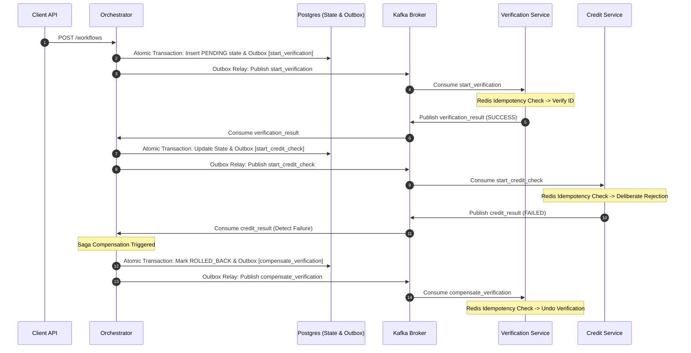

# FlowMaster

The Orchestrator loads its Saga steps from `orchestrator/workflow.yaml`. Workflow state changes and outgoing Kafka messages are committed together in Postgres; the Outbox relay publishes committed events to Kafka with at-least-once delivery. The Verification and Credit workers use atomic Redis claims and 24-hour completion markers to ignore duplicate workflow events. Redis is exposed by Docker Compose on `127.0.0.1:6380` to avoid conflicts with a host Redis service; set `REDIS_URL` to override the worker connection URL.

## Saga Workflow

